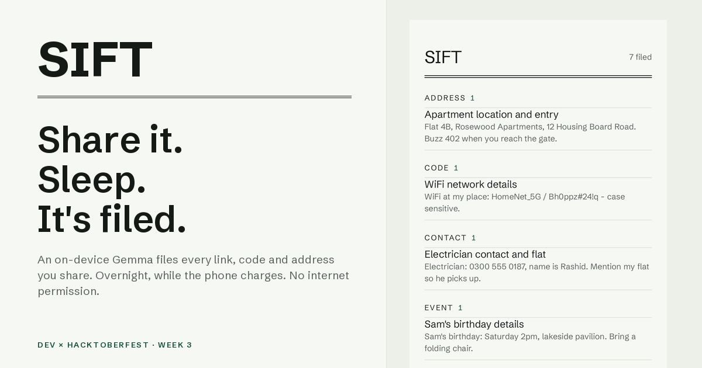

# Sift

**The junk drawer that files itself.**

See something worth keeping on your phone — an address, a WiFi password, a
gift idea, a recipe, a "watch this later" link — and don't feel like
organizing it? Share it to Sift. Two taps, phone back in your pocket.

Overnight, while the phone charges, a small language model (Gemma 4 E2B)
running **entirely on the phone** reads each saved snippet and files it:
picks the drawer (ADDRESS, CODE, CONTACT, EVENT, IDEA, LINK, LIST, RECIPE —
or INBOX when it can't decide) and writes a short title. In the morning the
drawer is a card catalog, sorted.

- **No INTERNET permission.** The app is physically incapable of sending
  your notes anywhere. Not "we promise" — the OS forbids it.
- **No accounts, no cloud, no subscription.** The model is open-weight and
  runs locally, so filing costs nothing — forever.
- **No formats to maintain.** No hardcoded rules per note type; the model
  reads each note the way you do, and a fixed 9-drawer taxonomy keeps it
  honest (it can't invent categories).
- **Fail-safe by design.** When the model's votes disagree, the note goes
  to INBOX for a two-tap manual move. Uncertain means INBOX; nothing is
  ever lost, and the verbatim text stays on every card.

Built for the DEV x Hacktoberfest Week 3 "Slow and Steady" challenge
(#hf26challenge). Kotlin, Jetpack Compose, Room, WorkManager, LiteRT-LM.
Android 9+, arm64.



## Download

**[Sift v0.1.0 — signed arm64 APK](https://github.com/Burry071/sift/raw/main/apk/Sift-v0.1.0-arm64.apk)**
(43 MB, Android 9+). It installs as `com.sift.app`.

Then set up the model, once:

1. Open Sift. The setup prompt offers **DOWNLOAD THE MODEL** — it opens
   Google's Gemma release page in your browser. Accept the license, download
   `gemma-4-E2B-it.litertlm` (~2.6 GB) from
   [litert-community/gemma-4-E2B-it](https://huggingface.co/litert-community/gemma-4-E2B-it).
2. Back in Sift, tap **I ALREADY HAVE THE FILE** and pick it with the system
   file picker. The first read compiles the model (a few minutes); after that
   every filing run starts fast.

The prompt also asks once whether Sift may post a notification while it files
overnight. Declining changes nothing — filing runs either way.

That's the only thing Sift ever asks for. Keeping notes is
**Share → Sift** from any app.

> **Note on the Gemma license:** the model weights are gated on
> Hugging Face under Google's Gemma terms. You accept the license in your
> own browser and hand the file to Sift yourself — Sift never downloads
> anything (it can't).

## Building from source

```
./gradlew :app:installDebug
```

If you prefer not to use the in-app import, on a **debug** build you can push
the model straight into the app's storage:

```
adb push gemma-4-E2B-it.litertlm /data/local/tmp/model.litertlm
adb shell run-as com.sift.app cp /data/local/tmp/model.litertlm files/model.litertlm
```

(`run-as` only works on debuggable builds, so the release APK needs the
picker once.)

Release builds sign themselves if `keystore/keystore.properties` exists
(git-ignored; see `app/build.gradle.kts`).

## How it works

Three layers:

1. **Keep (instant).** Any share lands verbatim in a local Room database,
   queued as UNFILED.
2. **File (overnight).** A WorkManager job — constrained to *charging +
   idle*, i.e. typically when you're asleep — reads each queued snippet
   with Gemma. Three samples, majority decides; disagreement or malformed
   output means INBOX. Short title written too, with a fallback to the
   snippet's first line if the model rambles.
3. **Browse (morning).** One screen: the card catalog. Drawers with counts,
   cards with titles over the verbatim note as evidence.

Impatient? **FILE NOW** in the UNFILED section runs the same job immediately.

## Calibration

The full prompt-design story (including the failed variants) is in the
challenge post. Raw per-snippet results and the 40-snippet test corpus
(all invented, no personal data) are committed under `corpus/`,
`scripts/`, and the repo root. Early runs replay against Ollama
(`node scripts/sift_test_v4.js`); the shipping-model runs replay against
LiteRT-LM (`python scripts/sift_test_v5.py`).

## Repo layout

```
app/            Android app (Kotlin, Compose, Room, WorkManager, LiteRT-LM)
corpus/         40-snippet calibration corpus (invented, labeled)
scripts/        Calibration spikes (Ollama + LiteRT-LM)
results_*.jsonl Raw per-entry results of every calibration run
apk/            Signed release builds
licenses/       Font license (Schibsted Grotesk, OFL)
```

## License

MIT for the code in this repository. Gemma model weights are subject to
Google's Gemma terms; the bundled font is OFL.
